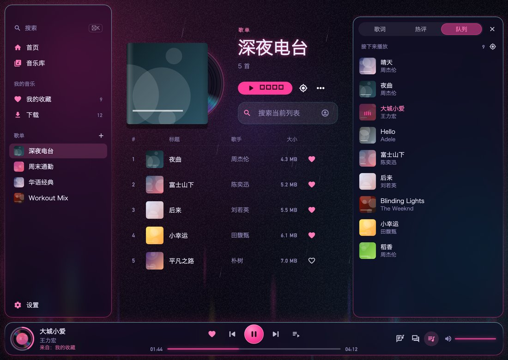
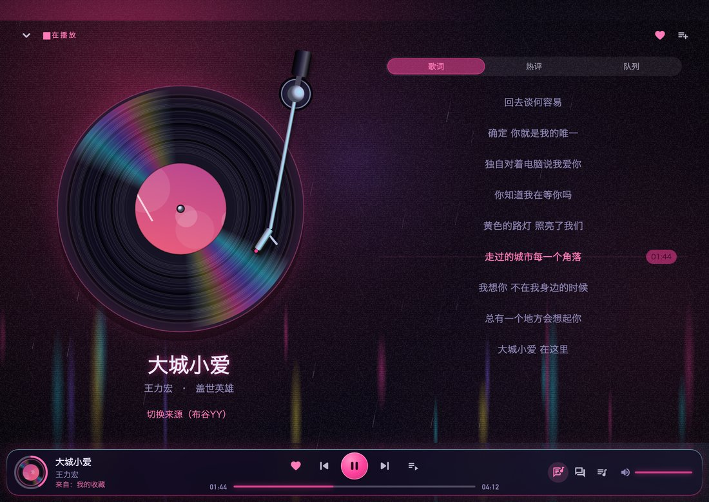

# Mac 初步运行

当前GitHub正式版为 **1.0.4（10269）**，已自动构建并发布：[下载Mac Universal ZIP](https://github.com/qiHuang112/ai_music/releases/download/v1.0.4-10269/ai-music-macos-1.0.4-10269-universal-69f7ce6544df.zip) · [Android／Mac完整Release](https://github.com/qiHuang112/ai_music/releases/tag/v1.0.4-10269)。支持Apple Silicon及Intel，24200116字节，SHA256 `69f7ce6544dfc04b9d32f7ba0ff097a8bb60175e40a8a4338f6e49fe78765c82`；源码4504319，原com.qi.ai.music.mac身份、沙箱／无调试权限及严格签名检查通过，ad-hoc签名，未Apple公证。GitHub上传后完整ZIP下载核验已通过，公开下载元数据与资产digest再次确认一致。

2026-10-25用户验收合作者桌面版并明确要求合入main、发布Mac到GitHub Release、恢复公开仓库和main自动打包。已恢复仓库public及Actions enabled；`.github/workflows/android-release.yml`增加Mac任务，在同提交Android发布成功后读取其最终版本号，构建Universal正式.app并校验身份、权限、签名和架构，再向同一个Release上传内容哈希命名的ZIP、校验文件及独立`macos-latest.json`。不覆盖Android的`latest.json`或旧ZIP；Mac仍为ad-hoc、未Apple公证。实现及发布结果见当日日志。

2026-10-25本机最新体验：按用户“拿下代码，看看合作者改了什么，跑起来”的要求，接入ui-vinyl原始提交6a4b5e3（父提交1504dbd），在当前main快进后构建并打开Debug1.0.4／10268，路径`build/macos/Build/Products/Debug/来听.app`。分析及25项桌面组件／播放器定向测试通过，实际看到新首页、队列、条形与方形迷你播放器，并返回完整首页；原深色皮肤、王力宏45首队列与《需要人陪》00:21暂停恢复。没有修改合作者运行源码；本次仅本地同步体验，未推送main或替换下述正式LAN包。此提交主要变化见本文“界面重设计”。

局域网现有正式包为2026-10-25用户验收的**桌面优化版1.0.4（10268）**，包含桌面交互、新图标和皮肤背景通顶。已完成临时增量review（最终No findings）、本机Release构建和一次完整LAN下载核验。版本沿用共享编号，以内容哈希区分本次包并保留第一版历史包。

- [下载当前Mac正式版](http://192.168.31.167:8788/releases/macos/ai-music-macos-1.0.4-10268-universal-3c0d3f5afe43.zip)：23862538字节，SHA256 `3c0d3f5afe43e361a36dc359597694fa8fb620526e6697a0e2b4e1e3cce8ed6a`。
- 当前运行归档：`/Users/huangqi/ClaudeProject/releases/ai_music/macos/apps/1.0.4-10268-desktop-9407e39b/来听.app`。Universal／原bundle／ad-hoc签名，未Apple公证；用户当前皮肤、王力宏45首队列、《大城小爱》01:44暂停状态保留。
- 审查期间定向复现搜索后切回设置使空格失效，已在页面／播放器切换时明确转移焦点并通过单项回归。增量构建的App.framework旧签名已按原Release权限刷新，严格深度验证通过。未操作Android latest、Git提交推送或CI。

2026-10-25用户验收初步运行并要求按Mac第一版走流程；版本与安卓／iOS／鸿蒙统一，本次Mac成品使用当前安卓正式版的1.0.4／10268，不另起1.0.0系列。Mac沿用独立bundle ID及数据目录，直接在本机打release并归档ZIP，通过现有LAN服务的Mac独立入口下载；不触发CI、不改Android最新指针。当前仅有开发用ad-hoc本地签名，不宣称Developer ID签名／Apple公证。

2026-10-25用户要求先把现有项目做成Mac版并在当前Mac打开体验，再沟通桌面优化。本轮复用现有Flutter功能与界面，补齐macOS工程、网络及本地存储／播放所需配置；不提前大改桌面布局，不提交或发布Android版本。

运行检查：应用能启动；现有首页／音乐库／设置可用；在线搜索和实际播放／暂停可用；没有启动异常或窗口溢出。桌面布局、快捷键、菜单栏等后续根据用户体验讨论。

初步运行已完成：新增macOS工程，应用名“来听”、bundle ID `com.qi.ai.music.mac`，默认1100×780、最小760×600；配置沙箱联网、本地音频代理及用户选定文件读取，沿用现有Flutter页面和播放实现。应用使用Mac独立数据目录。

当前体验包：`build/macos/Build/Products/Debug/来听.app`，可从Finder打开；开发启动使用 `/Users/huangqi/ClaudeProject/tools/flutter/bin/flutter run -d macos --no-pub`。已在当前Mac实际打开，首页／设置可见，搜索Adele返回22条，Hello音频进入ready并播放、暂停成功，窗口保留供用户体验；未记录Flutter／异步异常。`flutter analyze --no-pub`、plist及差异检查通过。保持原依赖锁定版本，未改Android／iOS源码或发布配置。完整桌面功能、截图OCR、系统分享及键盘交互尚待后续体验，不把本轮基础运行检查视为全部功能验收。

## 第一版发布完成

正式Mac版 **1.0.4（10268）** 已归档并在当前Mac打开，独立bundle与原数据保持，Hello以暂停状态恢复。Universal应用包含arm64和x86_64；当前Mac实际验证Apple Silicon，未另有Intel实机验收。Release使用ad-hoc本地签名，未做Apple公证；移除调试用get-task-allow，深度签名校验通过。

- [局域网下载ZIP](http://192.168.31.167:8788/releases/macos/ai-music-macos-1.0.4-10268-universal-cc999ad5c306.zip)，解压后将来听.app拖入应用程序。
- 应用永久归档：`/Users/huangqi/ClaudeProject/releases/ai_music/macos/apps/1.0.4-10268/来听.app`；ZIP22167782字节，SHA256 `cc999ad5c306ddb220784575ee7c4b3f0ddd9be0b20317d39cc05f2077bf0078`。
- 增量review初审1项P3（自动生成的测试宿主仍使用旧名称），修正后No findings；LAN新增Mac入口5项定向测试通过，HTTP完整ZIP下载及解压后的签名校验通过，Android latest10268保持。

后续所有平台对外版本号统一分配，不为Mac单独递增或新起系列。Mac版本由构建参数显式与共享正式编号对齐，不能直接照搬Android ABI偏移前的Flutter build number。

## Mac 交互设计（2026-10-25，用户已确认第一轮）

用户要求先参考主流PC音乐软件，结合来听的特点设计Mac交互，确认后再执行；初次讨论只制作方案，随后用户确认第一轮实施。七套皮肤的配色、字体、纹理、玻璃、背景雨滴／极光、封套、唱片／唱臂和播放键效果继续使用现有组件；只改变布局、入口与鼠标／键盘操作。对话中的可点击示意以当前霓虹雨夜为例，示例歌曲和占位唱片／歌词不代表真实数据或对材质的重制。

参考：[Spotify桌面布局说明](https://newsroom.spotify.com/2023-06-20/spotify-desktop-experience-redesign-your-library-now-playing-views-customize/)的左侧资料库、独立内容区和可收起右栏；[Apple Music Mac迷你播放程序](https://support.apple.com/zh-cn/guide/music/mus71d7dcfce/mac)的紧凑播控、歌词／队列显式入口。以下方案已于2026-10-25获用户确认，进入第一轮开发；同轮要求Mac图标采用现有 `branding/app-icon.png` 的“来听”薄荷音符标志。

- 主窗口：保留原生红黄绿窗口键和可拖动标题区；底部四Tab移到左侧导航。左栏首页／音乐库／我的收藏／下载，下面直接列出自建歌单，设置在底部。中央切换内容并记住各页滚动位置；搜索歌曲／歌单继续保留原auto及音源选择逻辑。
- 常驻播放条：保留玻璃胶囊、小唱片、原播放键；横向分成歌曲信息、上一首／播放／下一首及进度、音量／歌词／热评／队列。歌名或封面打开完整播放页，“来自：歌单／我的收藏”回到真实播放来源并定位当前歌曲；浏览其他歌单不改变播放队列来源。
- 右侧详情：歌词、热评、当前队列共用一个可收起面板，同一时刻只开一项。首次默认收起，之后记住用户选择；切歌不自动弹开。打开队列沿用260ms定位当前歌曲，用户主动滚动后不抢回位置，保留手动定位入口。热评默认合并三平台，每条标注来源，右上更多筛选；失败和空态继续沿用既有规则。
- 完整播放页：左侧现有唱机、歌曲信息及切换来源，右侧歌词，右侧也可切热评／队列；底部播控位置保持。返回原页面时恢复浏览位置。歌词加载占位、失败和无歌词保持同一容器，行高固定，加载完成不推动唱片／按钮；歌词滚动只发生在歌词区域。
- 列表：单击选中，双击或行首播放按钮播放；悬停给轻反馈，右键与三个点打开同一菜单。分享、加入歌单、切换来源（当前来源）、置顶保留；后两项继续纯文字，无前后装饰图标。键盘焦点与正在播放分开表示，歌曲／收藏／缓存状态沿用现有数据逻辑。
- 设置：在中央区域以分类＋内容呈现，减少整页来回跳转；新建歌单保持正常居中小弹窗，打开时一次完成布局，避免抖动。分类内容与皮肤设置沿用原有功能。
- 动效：更多菜单保持已验收的120ms；建议新导航切换约140–160ms，侧栏展开约180ms，完整播放页约220ms，定位沿用260ms；不加整屏弹跳，原唱片／唱臂／背景皮肤动效不改。减少动态效果设置继续有效。
- 窗口适配：默认1100×780、最小760×600保持。左栏建议190px，右栏约280px；宽度不足以维持可读中央区域时右栏变覆盖式侧面板，关闭即恢复，不把列表挤窄。主区与侧区分别滚动，播控常驻。
- Mac操作：⌘K聚焦全局搜索；非文字输入时空格播放／暂停；⌘←／→切歌；⌘,打开设置；Esc依次关闭菜单／面板／完整播放页；系统媒体键配合原生播放会话。关闭窗口继续后台播放，⌘Q才退出；退出后再次打开仍恢复原曲／来源／队列／进度，普通暂停状态，不自动播放、不新增“待播放”文字。

首轮范围：主窗口桌面布局、常驻播控、右侧面板、横向完整播放器、列表鼠标操作及基础快捷键。批量多选、拖歌入歌单、独立迷你窗口放下一轮讨论。第一轮与追加顶部修正均已获用户验收，review及LAN发布已完成，见本文顶部当前正式包。

## 第一轮体验版已运行

2026-10-25追加修正：用户已确认新图标正常，反馈Mac顶部白色原生标题栏与皮肤割裂。现启用透明标题栏及全尺寸内容区，让原背景延伸到窗口最顶端；原生红黄绿按钮与拖动区域保留，按钮外观跟随当前皮肤明暗。正文按原生contentLayoutRect预留顶部空间，窗口缩放／全屏时同步，避免播放器返回按钮与窗口按钮重叠。本机首页及完整播放页截图核对通过，定向分析／Debug构建通过，应用已重开停在首页；仅此UI修正，未跑功能全套或发布。

2026-10-25已实现上述桌面主体：190px左导航、保留各页状态的中央导航、常驻玻璃播控、300px按需右栏和横向唱机；窄窗口右栏覆盖显示。列表单击选中／双击播放／右键原菜单，设置分类页、进度与音量、播放来源定位和基础快捷键已接入。⌘K和⌘,同时接到Mac原生菜单；关闭窗口隐藏并保留音频会话，⌘Q退出。各平台版本仍统一1.0.4／10268，本轮是本机Debug体验，不替换已发布正式包。

Mac AppIcon全部尺寸已由现有 `branding/app-icon.png` 生成，1024px文件与品牌主稿逐字节一致，使用“来听”薄荷音乐标志；保留bundle `com.qi.ai.music.mac`及原Mac数据。皮肤绘制组件和配色未改。

原生自测发现Flutter 3.44的滑块OverlayPortal会使辅助功能树失效并触发AccessibilityBridge崩溃，采用Mac专用局部Overlay保留滑块样式和辅助功能，另为嵌套导航建立独立语义边界，修复后原生窗口及辅助功能树稳定。相关上游诊断：[Flutter #190357](https://github.com/flutter/flutter/issues/190357)。

验证：播放器／桌面／文件分享桥接共24项定向测试、静态分析及差异检查通过；本机实际检查侧栏歌词与热评、队列、完整唱机、设置外观分类、右键菜单、搜索／设置快捷键、空格播放暂停和关闭窗口后继续播放。已恢复原霓虹皮肤及Hello进度，最后停在首页，Hello约04:12普通暂停，侧栏收起。原生分享桥接编译及参数测试通过，未向任何外部应用发送文件。运行路径仍为 `build/macos/Build/Products/Debug/来听.app`，待用户体验；未review、提交、推送、CI或发布。

## 界面重设计（2026-10-25，`ui-vinyl` 分支）

用户觉得已有 Mac 版不够好看，要求参考网易云音乐、Apple Music 等桌面端重做样式与交互，标准是“让人惊呆这居然是 AI 做的”；音乐功能本身不改。七套皮肤的配色、纹理、玻璃、唱片／唱臂和背景动效全部沿用，下面只改 Mac 布局、组件样式和鼠标键盘交互。手机端不受影响（所有分支都以 `DesktopMusicScope` 或 `isMacMusicDesktop` 为条件）。

- **窗口框架**：左侧改为离窗边 10pt 的悬浮玻璃侧栏，红黄绿按钮落在侧栏顶部；顶部是“搜索 ⌘K”入口，下面分“首页／音乐库”“我的音乐（收藏、下载，带数量或下载中转圈）”“歌单（带小封面）”三组，设置在底部并保留更新红点。选中项用皮肤亮色淡底，悬停有浅底。可交互内容都在系统拖动区（约 28pt）以下。
- **底部播放条**：通栏悬浮玻璃条。左边是小唱片（悬停放大并提示展开／收起播放页）、歌名（悬停下划线，点击打开播放页）、歌手和“来自：…”来源链接；中间依次是收藏、上一首、播放、下一首、播放模式，下面是“已播时间 — 细进度线 — 总时长”；右边是歌词／热评／队列三个图标开关和音量。进度与音量改用桌面细线滑条：平时 3pt，鼠标移上去变粗并出现圆点，点按或拖动在松手时生效。按钮提示带快捷键（空格、⌘←／⌘→）。
- **右侧面板**：独立的悬浮玻璃卡片，顶部为 Mac 分段控件（歌词／热评／队列，滑动的高亮块）和收起按钮；队列行悬停显示播放键与“更多”，正在播放的歌显示跳动音柱。窄窗口时面板浮在内容上，不挤压列表。
- **首页**：标题区左边是按时间问候（早上好／晚上好…）加“我的音乐”，右边是搜索框；面板打开导致变窄时搜索框换到标题下方。默认内容改为桌面仪表盘：正在播放大卡片（唱片从封套里滑出、随封面取色泛光、播放／打开播放页／歌词）、我的收藏卡片（四格封面拼图）、常听歌单封套网格（悬停唱片滑出并转动）、两家平台的榜单色块。搜索结果、历史与歌单搜索沿用原有面板。
- **歌单／收藏／榜单页**：桌面头部为 176pt 封套加唱片、类别小标、大标题、歌曲数（榜单附更新时间）和一行操作（播放全部、原有的定位／排序／同步／更多，搜索框在右侧，窄时换行）。歌曲改为带表头的表格：序号（悬停变播放键，正在播放显示音柱）、封面、标题、歌手、专辑（宽度不足时隐藏）、大小、收藏与“更多”（悬停出现，右键菜单仍可用）。单击选中、双击播放、长按进入多选的行为不变。
- **音乐库**：自建歌单和榜单歌单改为封套网格；其余入口不变。
- **播放页**：左侧唱机随窗口放大（最大 440pt），下方是歌名、歌手 · 专辑和切换来源；右侧歌词／热评／队列共用分段控件；顶部是收起按钮、“正在播放”小标、收藏和加入歌单。
- **设置**：页面大标题，左侧带图标的分类，右侧内容放进玻璃卡片。下载页“已下载”行改为与歌单表格一致的列布局。
- **快捷键**：新增 ⌘[ 返回（播放页时收起播放页）与 ⇧⌘M 迷你播放器，其余沿用 ⌘K、⌘,、空格、⌘←／⌘→、Esc（迷你模式下 Esc 回到完整窗口）。

- **第二轮（同日，用户试用后追加）**：
  - 红黄绿按钮移进侧栏玻璃面板内（原生把按钮定位到离窗左 26pt、中心离顶 28pt，并把标题栏收窄到只包住三个按钮，隐藏它自带的底色和装饰层）。窗口顶部其余部分交给应用：侧栏顶条、内容区工具栏和播放页顶条都可拖动窗口；双击则“铺满屏幕可用区域”（菜单栏以下、程序坞以上），再双击回到原尺寸，不进入全屏。原生 `zoom` 的标准尺寸改为屏幕可用区域。
  - 内容区新增顶部工具栏，仿网易云：左边返回（⌘[），右边换肤（七套皮肤，带底色／亮色色样）、迷你播放器（⇧⌘M）、设置（⌘,，带更新红点）。侧栏底部的设置入口移到这里，歌单页头部的返回键也由工具栏统一提供。
  - **迷你播放器**，对照用户本机网易云音乐的迷你模式逐项复刻（同一窗口，置顶，可拖动，原生隐藏红黄绿）：
    - 迷你条 336×52：左缘上下叠放的 × 与 □，34pt 封面，歌名和“歌手 -- 专辑”，底部进度细线；鼠标移入时歌名区换成上一首／播放／下一首。右侧依次是喜欢、删除（从播放队列移除当前歌并播下一首）、“词”、音量（点开后在条内显示音量滑条）。
    - 方块 336×336：鼠标不在时只显示歌词（当前句高亮居中）或整幅封面，“词”在两者间切换；鼠标移入时顶栏（× □、歌名、“…”菜单：置顶开关、收成迷你条、回到完整窗口）和底栏（封面、上一首／播放／下一首、喜欢、删除、词、音量、带圆点的进度线）淡入。
    - 迷你条上点“词”展开成方块歌词；点封面在迷你条与方块间切换，底边不动（经用户指出后在网易云上确认：方块点封面收成迷你条、迷你条点封面展开，窗口底边保持不变）；拖动窗口下边缘也会吸附到两者之一；切换时窗口不会越过菜单栏或程序坞。× 隐藏窗口但继续播放，□ 或 Esc 回到完整窗口；完整窗口的页面和浏览位置在迷你模式期间保持不动。形状、歌词／封面、置顶写入 `macos-window.json`。
    - “…”（以及在迷你播放器任意处右键）弹出系统原生菜单，可超出小窗口边缘，按网易云的菜单逐项对应本应用已有功能：播放／暂停、查看评论（回到完整窗口并打开播放页热评）、添加到歌单（网易云的“收藏”）、下载（用当前歌曲已选音源走与搜索结果相同的下载；已下载显示为不可点的“已下载”）、分享、歌手：X 与 专辑：Y（回到完整窗口在首页搜索）、来自：X（回到播放来源，无可打开的来源时为灰色）、保持在最前（勾选）。网易云的“复制链接”“减少推荐”本应用没有对应功能，未加。
    - 迷你播放器的按钮提示改用系统原生提示小窗（显示在按钮下方，屏幕底部不够时改在上方），解决 52pt 高的迷你条里 Flutter 提示被窗口边缘截掉一半的问题。
  - **榜单色块随皮肤配色**：深色与霓虹保持；白天为奶油底配嫩叶绿／麦色／砖红印字；草莓牛奶为草莓、奶黄、薰衣草、蜜桃四种奶色配可可色字；孔版印刷为克莱因蓝或荧光橙满版、或再生纸加网点，硬投影；极光为深夜玻璃配各自光幕色；银箱为黑色显示窗配琥珀灯色字和底部指示灯。
  - **极光闪烁**：离屏逐帧扫鼠标未能复现（亮度无跳变），判断为 Mac GPU 路径上实时模糊覆盖在运动的极光光幕上、鼠标引发的额外重绘拿到旧背景造成；Mac 上极光皮肤的玻璃面板改为不做实时模糊的磨砂色，其余皮肤不变。另修正 Mac 上日期分组标题条按页面而非窗口取背景导致的错位。修复后的闪烁情况待用户在真机确认。

实现：新增 `lib/src/presentation/desktop_ui.dart`（悬停行、工具按钮、分段控件、细线滑条、按键帽）与 `desktop_home.dart`（首页仪表盘、封套卡片与网格），改写 `desktop_music_shell.dart` 的侧栏／播放条／面板，并在 `music_home_page.dart`、`player_page.dart`、`settings_page.dart`、`download_manager_page.dart`、`list_search.dart` 中加入桌面分支。

验证：`flutter analyze` 无问题；全量 1088 项测试中 1083 项通过，失败的 5 项（`widget_test.dart` 4 项、`online_playlist_import_test.dart` 1 项）在不含本次改动的 `1504dbd` 上同样失败，与本次无关。新增 `test/desktop_ui_test.dart` 5 项，更新桌面外壳测试（队列开关改按提示查找，补 ⌘[ 与侧栏搜索）。用 `test_render/mac_screens_test.dart` 离屏渲染七套皮肤的首页、歌单、播放页、面板，以及 760×600 最小窗口，均无溢出。本机 Debug 构建（arm64，命令行把最低系统临时设为 macOS 12 以适配 Xcode 27，未改工程文件）已打开；未在真实窗口里逐项操作验收。
